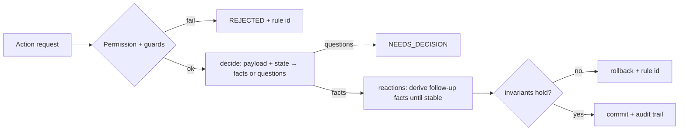

# Architecture v1: first draft

> **Provenance (corrected after review):** Written by Claude (AI coding agent) on 28 Oct 2026. Ansh chose to "co-write" v1 in the chat, said he didn't know which direction to take, and asked Claude to suggest one. He contributed no text of his own to this draft. "I" below means the agent.
> Inputs at this point: the assignment PDF, `docs/candidate-walkthrough/*`, and a skim of `actions.service.ts` and `common/domain.ts`. The domain services had **not** yet been read in depth.
> Later drafts record what changed and why.

## 1. The problem as I understand it

FieldDesk is a CRM covering orders, shipments, returns, receipts, credit notes, and reward points.
Every action (`EDIT_ORDER`, `CONFIRM_DELIVERY`, ...) is legal only for certain roles and states, and it ripples into other ledgers:

- delivery creates a charge;
- a charge triggers cash allocation;
- cash earns points.

If each _scenario_ (action × actor × relevant state) is coded as a branch, scenario count grows as `Σ |V_a|R_a|`.
Every new rule then touches many branches.

**Goal:** write code **once per rule**, not once per scenario, and let composition cover the scenarios.

## 2. Key observation: rules come in a few kinds

| Kind         | Example from canonical rules                          | Natural home                               |
| ------------ | ----------------------------------------------------- | ------------------------------------------ |
| Permission   | Only KAM approves (roles table)                       | A table: action → roles                    |
| Guard        | ORD-003: ordinary edit only before dispatch/cancel    | A precondition attached to an action       |
| Transition   | ORD-005: Submit `DRAFT` → `PENDING`                   | A state-transition table per entity        |
| Invariant    | FUL-001 `0 ≤ r ≤ d ≤ s`; ACC-001 `b_j ≥ 0`            | A predicate checked after **every** action |
| Derivation   | REW-001 entitlement, fulfillment status, `b_j`, `u_i` | A pure function of stored facts            |
| Reaction     | WF-005 delivery → charge; WF-002 allocation occasions | "When X happens, then do Y" rules          |
| Compensation | WF-001 posted values change only via linked entries   | A generic "reverse / adjust" mechanism     |

If each kind gets one mechanism, then adding a scenario usually means adding one row or rule, not editing several services.

## 3. Proposed shape (first guess)



1. **Action specs.** Each action is declared in one place:
   - who may perform it;
   - which guards apply, each referenced by canonical rule id;
   - what it reads;
   - a `decide` function that returns new facts or questions.
2. **Invariants registry.** Module invariants are written as named predicates (`ORD-001`, `FUL-001`, `ACC-001/002`, `CRD-001`, `CUS-001`). They run inside the transaction after every action. A violation rolls back and names the rule.
3. **Reactions.** These are `when <fact> then <policy>` rules, for example "when a delivery is confirmed, create one goods charge (WF-005) and allocate free cash (WF-002/ACC-003)". They run until no new facts appear.
4. **Derived values instead of hand-maintained ones.** Reward buckets, balances, and fulfillment status are computed from facts where possible. A correction then becomes "add a fact, recompute, post the difference".
5. **Planner for corrections.** Given `(action, payload, current state)`, it returns either mutations or **questions** (the hint's "state reconciliation engine"). The skim shows the dispatcher already supports a `NEEDS_DECISION` result, so the plumbing exists.

## 4. The two features under this shape (rough)

**FDSK-169: move a payment to the right customer** (Accounts)

1. Record a linked reversal of the receipt at the wrong customer and a new receipt at the right customer. We don't edit `customer_id`, because WF-001 requires history to be preserved.
2. The wrong customer's charges that were settled by that cash become outstanding again.
3. Points earned from that cash are recomputed. If they were already redeemed, the shortfall becomes clawback pending (REW-003).
4. The right customer gets a normal cash-allocation pass (ACC-003).
5. **Question / block:** what if the receipt funds a credit note that was already applied or refunded? Credit cannot cross customers (CUS-001).

**FDSK-170: correct an overstated delivery** (KAM)

1. Record a delivery correction (−4 units) linked to the original confirmation.
2. A linked negative adjustment on that confirmation's goods charge (WF-005 allows exactly one charge per confirmation).
3. Release any settlement above the new charge value, back to its sources.
4. Recompute points (possible clawback).
5. The shipment goes back from `DELIVERED` to `DISPATCHED` so Warehouse can confirm the 4 later.
6. **Question / block:** what if the corrected quantity is below the quantity already returned (FUL-001 requires `r ≤ d`)?

## 5. How rules might read (sketch)

```ts
action('CONFIRM_DELIVERY', {
  who: ['WAREHOUSE'],
  when: [shipmentIs('DISPATCHED')], // FUL-006
  then: [recordDelivery, chargeOnDelivery, allocateFreeCash], // WF-005, WF-002
});
```

The aim is that someone who isn't technical could read the `who / when / then` list next to the canonical rule ids.

## 6. Open questions (to answer by reading the code)

- How much of this already exists? The dispatcher already has a single endpoint, idempotency, optimistic versions, a post-action consistency review, and `NEEDS_DECISION`.
- Are reward postings derived or written imperatively? This decides whether "recompute and post the difference" is cheap.
- Does WF-003 return-settlement already implement "release settlement back to its sources"? If so, FDSK-170 should reuse it.
- Should every existing action move to the new spec format, or only a representative slice plus the two new features? This is a scope vs. risk trade-off with a deadline of 31 Oct.
- How do I keep the 251 existing tests green during the change?

## 7. Not doing (for now)

Microservices, queues, event-sourcing the whole database, external rule engines such as Drools, and UI work beyond what the two features need.
