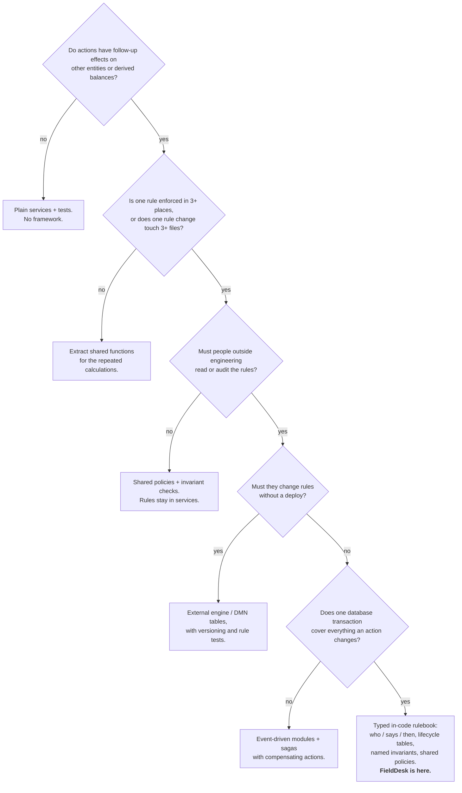

# When to invest in a rules framework

Deliverable 3. This is a decision tree plus a scorecard for choosing between plain code, a middle-ground in-code rulebook (what FieldDesk now has), and a full rules engine. Every FieldDesk number below was measured in this repository; the commands are at the end.

## The trade-off in one sentence

Framework code is a fixed cost that is paid back per rule. It is worth building when **(number of rules) × (how often they change) × (cost of getting one wrong)** is larger than the cost of owning the framework. When rules are few, stable, or cheap to get wrong, ten branches beat a rules engine.

## Decision tree



Two further questions apply on any branch:

- **Are posted facts ever corrected?** If so, make history append-only, write corrections as linked compensating entries, and derive balances from the facts (derive, compare, post the difference). FieldDesk's reward refresh already worked this way. Both user stories are corrections, and both reuse the pattern.
- **Is a wrong outcome expensive (money, compliance)?** If so, check named invariants inside the transaction, whatever else you choose. This is the cheapest guard with the most leverage.

## Scorecard

| Signal                         | How to measure                                              | Leans to plain code | Leans to a rulebook      | Leans to an engine                   | FieldDesk (measured)                                                                                                                                                                                                                                                                                                                                                   |
| ------------------------------ | ----------------------------------------------------------- | ------------------- | ------------------------ | ------------------------------------ | ---------------------------------------------------------------------------------------------------------------------------------------------------------------------------------------------------------------------------------------------------------------------------------------------------------------------------------------------------------------------- |
| Rule duplication               | Number of places one rule is enforced                       | 1                   | 3+                       | 3+ across services or teams          | Before: role checks in 20 service methods plus role lists in 14 client lines; allocate/refresh tails copied into 6 handlers; charge and receipt arithmetic in 10 places. After: 1 rulebook (server and client both use `can()`; the only remaining role lists guard customer creation, which is a separate endpoint and not a rulebook action) and 1 settlement module |
| Change amplification           | Files touched to add one action or change one rule          | ≤ 2                 | 3–6                      | Many services or deploy units        | Adding `CORRECT_DELIVERY` touched 12 non-test source files. Most of that was data-model work any solution needs (migration and snapshot, model, two repositories, contracts, audit text). The rule-specific part was 1 rulebook entry, 1 lifecycle row, 1 handler line and 1 service method. The ~90-line release logic was reused, not copied (Solution B copied it)  |
| Scenario growth vs rule growth | Naive `act × atn × Π sᵢ` against the number of declarations | Scenarios < ~20     | Scenarios ≫ declarations | Same, and rules change weekly        | 2,640 naive combinations vs 51 declarations (`docs/solution/RULES.md`)                                                                                                                                                                                                                                                                                                 |
| Readers outside engineering    | Does someone outside engineering review rules?              | No                  | Yes, read-only           | Yes, they also edit                  | Read-only: a generated, test-guarded rulebook page                                                                                                                                                                                                                                                                                                                     |
| Rule change frequency          | Rule changes per month                                      | Rare                | Monthly                  | Weekly, without engineers            | Unknown for a take-home. The canonical rules are versioned (`2026-10-26.1`), which suggests periodic change                                                                                                                                                                                                                                                            |
| Cost of a wrong rule           | Money or compliance exposure                                | Low                 | High → add invariants    | High → add rule tests and governance | High (cash, credit, points). The 14 pre-commit checks already existed upstream; this work named each after its rule and ran them for every affected customer                                                                                                                                                                                                           |
| Transaction boundary           | Does one transaction hold everything an action changes?     | Yes                 | Yes                      | No → sagas                           | Yes, one SQLite transaction per action                                                                                                                                                                                                                                                                                                                                 |
| Framework ratio                | Lines of framework mechanism vs lines of domain logic       | n/a                 | Mechanism ≪ domain       | Mechanism can exceed domain          | ~707 lines (rulebook data and docs renderer 455, handlers 75, settlement 177) vs 2,954 lines of domain services                                                                                                                                                                                                                                                        |
| Defect containment             | Do deliberately broken policies get caught before commit?   | Tests only          | Tests + invariants       | Tests + invariants + rule simulation | 4 mutation checks, all caught: <br>• delivery-correction release disabled → 3 tests failed, naming `ACC-001` <br>• payment-move allocation release dropped → failed, naming `ACC-002` <br>• second affected customer dropped → 2 tests failed <br>• credit-funding withdrawal skipped → 2 tests failed, naming `ACC-002`                                               |

**How to use the scorecard.** Score each row −1 (plain code), 0 (rulebook), or +1 (engine). A total at or below −3 means don't build a framework. A total from −2 to +3 means a middle-ground rulebook. Above +3, evaluate an engine, but prototype both, as Fowler recommends. These thresholds are judgement calls, not research results. Revisit them after the first few rule changes.

## Why FieldDesk lands in the middle

- **It is a rulebook, not an engine.** Engineers change the rules and deploy, so a runtime rule editor would add governance cost with no user to benefit. Chained forward rules (Drools style) would also hide the order of reactions, which is the property this domain needs most (cash before points, release before allocation). See [architecture v3](architecture/03-post-research.md).
- **It is declarative where the rules are tabular, and code where they are algorithms.** Permissions, follow-ups, status changes and post-conditions are declared. Cash allocation order (ACC-003), the WF-003 release, reward derivation and credit rules are algorithms, so they live in code, each in exactly one place. The "51 declarations vs 2,640 scenarios" figure measures the declared part only.
- **It is more than refactoring.** Rules were duplicated in 3 or more places, and the two user stories needed logic that existed only inside returns. Without the shared policy, FDSK-170 would have copied ~90 lines of release logic.
- **It does not use sagas.** One SQLite transaction already provides all-or-nothing behavior, and a rollback is simpler than a compensating event.

## When this design stops being enough

| Trigger                                                               | What to add                                                                                                                                                            |
| --------------------------------------------------------------------- | ---------------------------------------------------------------------------------------------------------------------------------------------------------------------- |
| Business users must change permissions or lifecycles without a deploy | Store `RULEBOOK` and the lifecycle tables as versioned data (they are already plain data), with an approval workflow and rule tests                                    |
| Reactions become a graph rather than two ordered steps                | Declare dependencies between policies and derive the order (topological sort) instead of a fixed `REACTION_ORDER`                                                      |
| Actions span services or databases                                    | Module events + sagas; turn invariants into reconciliation jobs                                                                                                        |
| Customers with thousands of orders                                    | Reward refresh and invariant review recompute per customer; switch to incremental projections and spot checks                                                          |
| More correction types                                                 | Each correction so far is "reverse the newest linked fact, release settlement, let reactions recompute". Extract that into one helper once a third correction needs it |

## Commands behind the numbers

```sh
grep -rc "authorize(" server/src --include=*.service.ts   # 20 before (commit 63fbc8f), 0 now
wc -l shared/src/rulebook*.ts server/src/actions/handlers.ts server/src/settlement/*.ts
wc -l server/src/*/*.service.ts | tail -1
pnpm rules:doc                                            # declarations vs naive count
```
